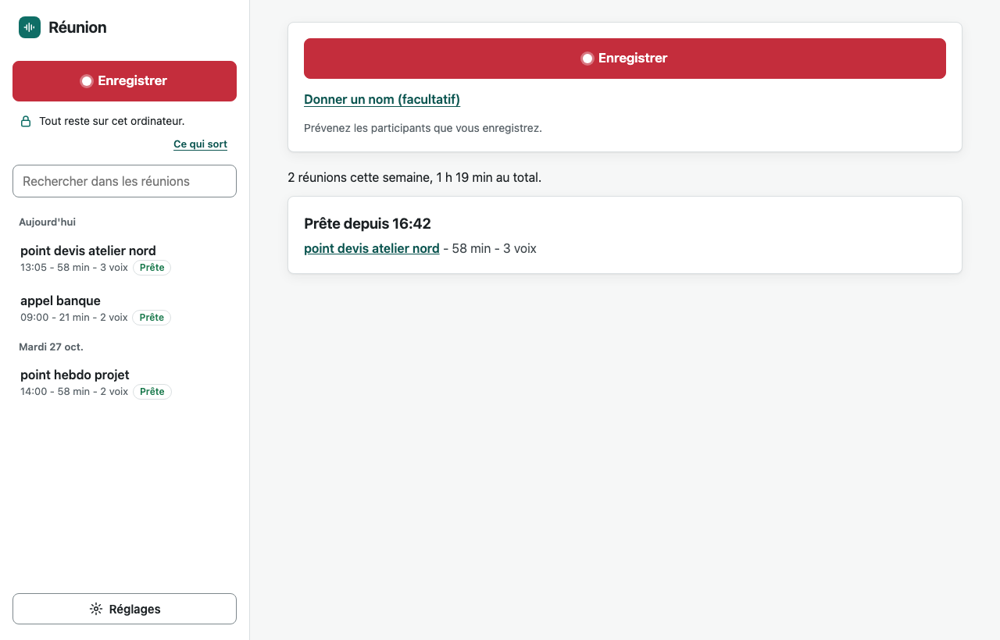
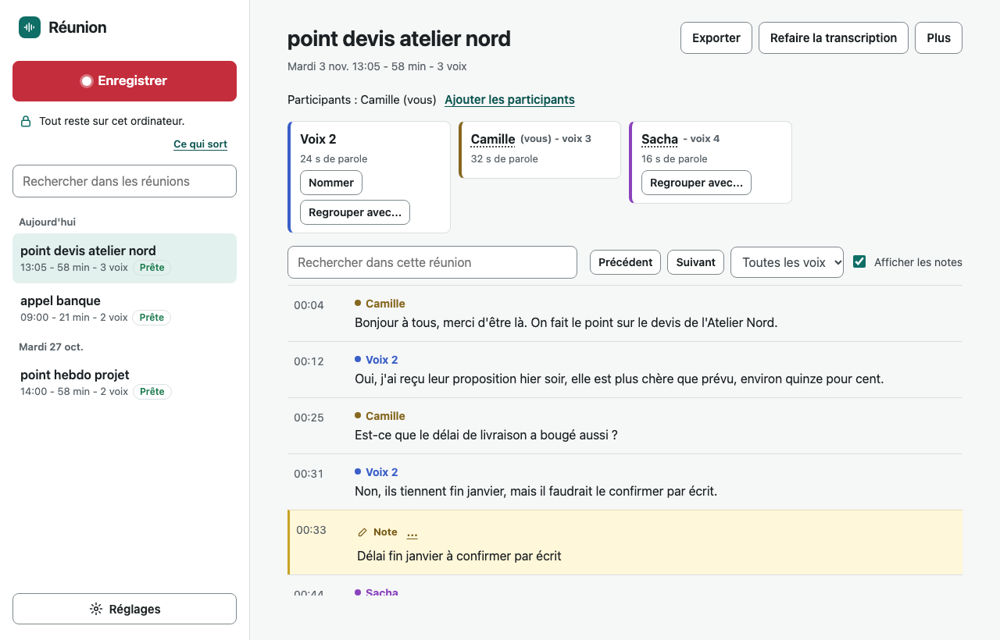

# Réunion

Réunion enregistre vos réunions, en visio ou en salle, et les met par écrit : qui parle, à quelle minute, avec vos notes au bon endroit. Tout se passe sur votre ordinateur : ni le son ni le texte ne sont envoyés sur internet. Gratuit, sans compte, pour Mac (puce Apple) et Windows 10 ou 11.





- **Un bouton pour enregistrer.** Votre micro et le son de l'ordinateur (les participants à distance) sont enregistrés séparément.
- **En direct** (sur un ordinateur assez puissant) : un brouillon de la transcription s'affiche pendant la réunion.
- **Notes horodatées** : tapez une note pendant la réunion, elle se range à l'instant où vous l'avez écrite. Un clic sur l'heure fait réécouter.
- **Voix séparées et reconnues** : chaque voix est numérotée. Vous la nommez d'un clic, l'outil propose les participants de l'agenda. Avec l'accord de la personne, sa voix est reconnue aux réunions suivantes.
- **Recherche** dans toutes les réunions, **export** en texte ou en Word.

## Installer sous Windows

Pour Windows 10 ou 11 (64 bits). Ni terminal ni droits d'administrateur. Comptez 5 Go libres et environ 15 minutes la première fois.

1. Sur cette page GitHub, bouton vert **Code**, puis **Download ZIP**. Faites un clic droit sur le ZIP, **Extraire tout...**, et rangez le dossier dans un endroit stable hors OneDrive, par exemple `C:\Users\vous\reunion`. Ne le déplacez plus ensuite.
2. Dans ce dossier, double-cliquez sur **`install.cmd`**. Si Windows affiche « Windows a protégé votre ordinateur », cliquez **Informations complémentaires**, puis **Exécuter quand même** : c'est normal pour un fichier venu d'internet qui n'est pas signé par un éditeur (son contenu est lisible dans `install.ps1`). Laissez la fenêtre ouverte jusqu'au message « Installé » : elle peut sembler figée pendant les téléchargements.
3. Double-cliquez sur le raccourci **Réunion** (bureau ou menu Démarrer). Une icône apparaît près de l'horloge et la page s'ouvre dans le navigateur.

Si Windows refuse le micro : Paramètres > Confidentialité et sécurité > Microphone, autorisez les applications de bureau.

## Installer sur Mac

Pour un Mac à puce Apple (M1 ou plus récent), macOS 15 ou plus, 5 Go libres.

1. Installez les outils de développement d'Apple (une seule fois) : ouvrez Terminal et tapez `xcode-select --install`. Installez aussi Homebrew (https://brew.sh).
2. Dans Terminal :
   ```
   git clone https://github.com/FranckLM3/reunion-local.git ~/reunion
   cd ~/reunion
   ./install.sh
   ```
3. Ouvrez **`~/Applications/Réunion.app`** : une icône d'onde apparaît dans la barre des menus. Au premier enregistrement, macOS demande deux autorisations pour Réunion, dans Réglages Système > Confidentialité et sécurité : **Micro** et **Enregistrement de l'écran et de l'audio système** (c'est ce qui capte le son de la visio). Accordez-les, puis quittez et rouvrez Réunion.

## Utiliser

1. **Premier lancement** : la page vous guide (votre nom, le micro, le son de l'ordinateur) et prépare seule les fichiers de transcription. La qualité est choisie selon votre ordinateur. Vous pouvez enregistrer pendant la préparation.
2. **Enregistrer** : bouton **Enregistrer** dans la page, dans le menu de l'icône (Mac) ou dans le menu de l'icône près de l'horloge (Windows). Prévenez les participants que vous enregistrez.
3. **Arrêter** : la transcription démarre seule, avec son heure de fin estimée. Vous pouvez fermer la page en attendant.
4. **Relire** : cliquez la réunion dans la liste. Nommez les voix, ajoutez des notes, cherchez, exportez.

L'accès à la page : menu de l'icône, **Ouvrir mes réunions**.

Si plusieurs personnes parlent dans la salle et que personne ne parle à distance, Réunion le voit et sépare les voix du micro tout seul.

## Où sont mes fichiers

- Réunions : dossier `Reunions` de votre dossier personnel (`C:\Users\vous\Reunions` ou `~/Reunions`), un dossier par réunion (son, transcription, notes). Bouton **Ouvrir le dossier** dans la page.
- Réglages et voix retenues : `.config/reunion` dans votre dossier personnel, lisibles par vous seul.

## Ce qui sort de votre ordinateur

Rien de vos réunions. Internet ne sert qu'à :
- l'installation (Python et bibliothèques) ;
- télécharger une fois les fichiers de transcription et de séparation des voix ;
- lire votre agenda Google si vous le branchez (lecture seule, pour le titre et les participants) ;
- vérifier s'il existe une nouvelle version.

La page n'est accessible que depuis votre ordinateur.

## Mettre à jour

- Windows : téléchargez le nouveau ZIP, extrayez-le dans le même dossier en remplaçant les fichiers, puis double-cliquez sur `install.cmd`. Vos réunions et réglages ne sont pas touchés.
- Mac : `cd ~/reunion && git pull && ./install.sh`.

La page signale quand une nouvelle version existe (Réglages).

## Désinstaller

Réglages, **Effacer les fichiers de Réunion** retire réglages, voix retenues et fichiers téléchargés par Réunion. Supprimez ensuite le dossier de l'outil et, si vous le souhaitez, le dossier `Reunions` (vos enregistrements). Sous Windows, supprimez aussi les raccourcis Réunion ; sur Mac, `~/Applications/Réunion.app`.

## Si ça ne marche pas

| Ce que vous voyez | Quoi faire |
|---|---|
| Les participants à distance n'apparaissent pas | Sous Windows, Réglages : choisissez la sortie où vous entendez la visio (casque ou haut-parleurs) et testez son niveau. Sur Mac, vérifiez l'autorisation « Enregistrement de l'écran et de l'audio système ». |
| Micro silencieux | Vérifiez l'autorisation du micro (voir l'installation), puis le test de niveau dans Réglages. |
| Transcription lente | Normal sans carte graphique. Réglages avancés : choisissez une qualité plus rapide. |
| La page n'affiche rien | Ouvrez-la depuis le menu de l'icône, **Ouvrir mes réunions**. |
| Une erreur s'affiche | Elle donne la cause, quoi faire et le chemin du journal. Joignez ce journal si vous signalez le problème sur GitHub. |

## Avancé

- Séparation des voix de meilleure qualité avec pyannote : Réglages avancés, collez une clé Hugging Face (compte gratuit et conditions à accepter sur https://huggingface.co/pyannote/speaker-diarization-community-1).
- Ligne de commande : `transcribe.py <dossier>` avec `--modele`, `--langue`, `--personnes N`, `--sans-locuteurs`.
- Dossier des réunions imposé : variable `REUNION_DIR`.

## Licences et remerciements

Réunion est sous licence MIT (fichier `LICENSE`). Il s'appuie sur :

| Composant | Licence |
|---|---|
| Whisper (OpenAI), mlx-whisper, faster-whisper | MIT |
| sherpa-onnx (k2-fsa) | Apache-2.0 |
| Segmentation pyannote 3.0, en ONNX | MIT |
| NVIDIA TitaNet-small (empreintes de voix) | CC-BY-4.0 |
| pyannote speaker-diarization-community-1 (option) | CC-BY-4.0, accès contrôlé |
| Extrait de test : « Les anciens canadiens », P. Aubert de Gaspé, LibriVox | Domaine public |
